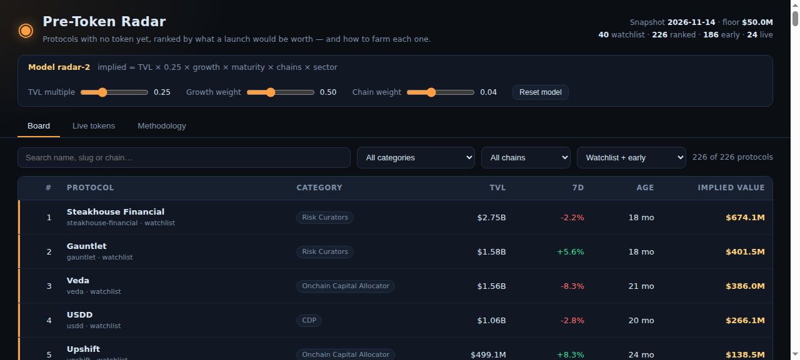
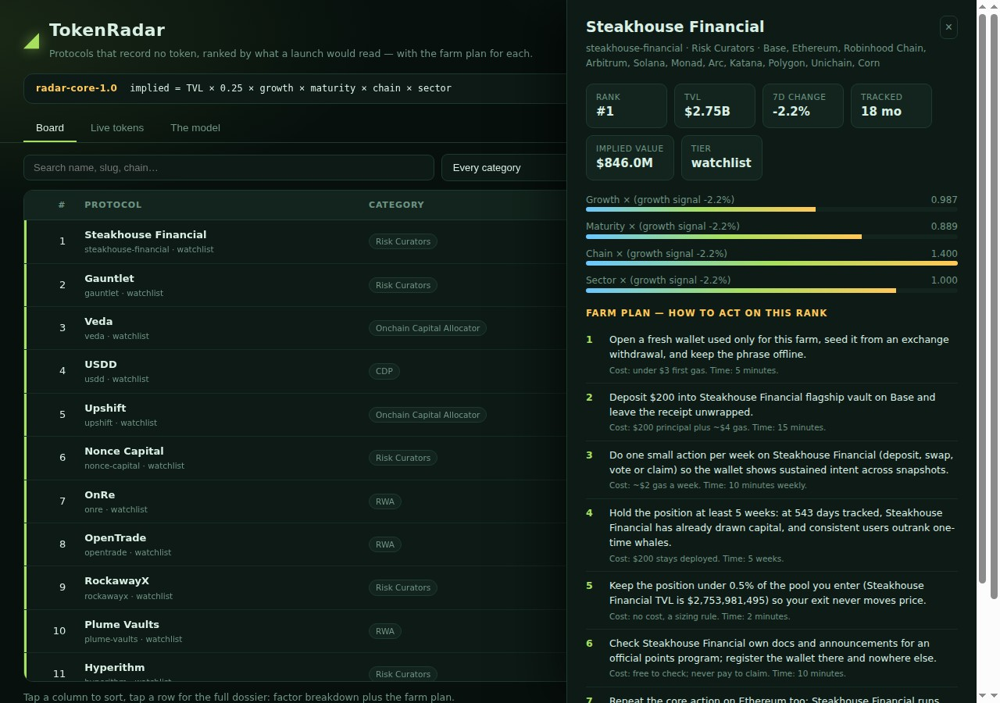
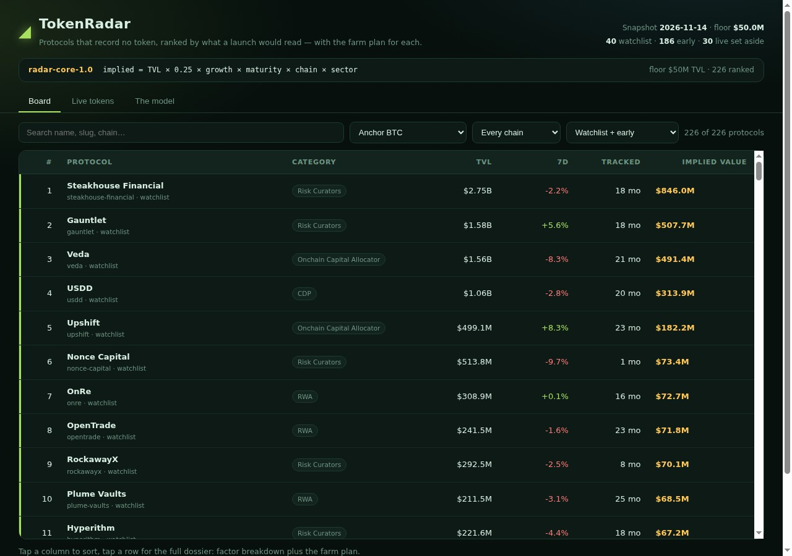

# Pre-Token Radar

Which pre-token protocol is worth farming next — and what to do about it.

A make.fun **token-radar-01** entry: it reads the sealed DefiLlama snapshot, finds every protocol that records no token, and ranks them by **implied value** — what a token launch would plausibly be worth:

```
implied = TVL × 0.25 × growth × maturity × chains × sector
```

- **growth** — recent TVL momentum, clamped
- **maturity** — age of the protocol, capped
- **chains** — multi-chain deployment bonus
- **sector** — category weight (the sector a launch pays from)

## What it produces

- `out/board.json` — the ranked board: watchlist (floor $50M TVL) plus the strongest pre-token protocols below the floor, each with a step-by-step farm plan.
- `out/dossier.json` — per-protocol detail: multiplier breakdown and the reasoning.
- `out/dashboard/` — an interactive page: sortable board, live-token comparison tab, methodology, and a model sandbox with live rescoring sliders.

## Run

```bash
mkdir -p out && MAKEFUN_OUTPUT_DIR=out node main.ts --input <path>/snapshot.json
```

Then open `out/dashboard/index.html` (served over HTTP).

## Screenshots





## Badges

[](https://make.fun/c/token-radar-01)
[](https://make.fun/c/token-radar-01)
[](https://make.fun/c/token-radar-01)

## License

MIT
